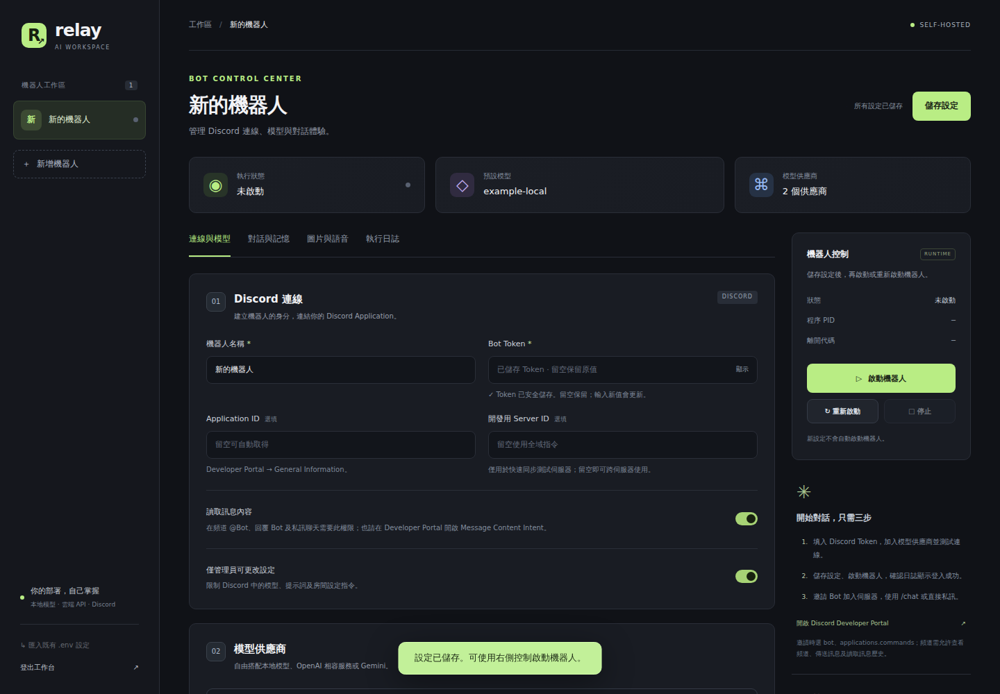

# Discord AI Control Panel

自架 Discord AI Bot 控制台，提供 Windows 桌面 GUI、Web 管理介面，以及 Docker／Kubernetes 部署方式

可自行設定 Discord Token、模型 API、對話記憶、角色參考圖、ComfyUI 生圖與 TTS



## 模型服務

- Ollama：本機或遠端，可設定多個實例
- OpenAI 相容 Chat Completions：OpenAI、Grok、DeepSeek、OpenRouter、vLLM 等相容服務
- Google Gemini 原生 API
- Anthropic Claude 原生 Messages API

API 可用模型、權限與參數以供應商實際服務為準

本專案不附 API Key 或模型權重，也不代表支援每家供應商的所有專屬功能。聊天目前是文字模式，不會自動執行工具或讀取圖片附件

## 快速開始：Web 版

需要 Python 3.12 或以上

```bash
git clone https://github.com/clare8151214/discord-ai-control-panel.git
cd discord-ai-control-panel
python3 -m venv .venv
.venv/bin/python -m pip install -r requirements.txt
export CONTROL_PANEL_PASSWORD='請改成至少12字元的獨立管理密碼'
.venv/bin/python -m web
```

開啟 `http://127.0.0.1:8080`，登入後建立 Bot

貼上 Discord Bot Token、驗證身分及取得邀請連結，再設定模型服務、測試連線並選擇模型，最後按「儲存並啟動」

Discord Developer Portal 與控制台需同時開啟 Message Content Intent，才能使用多人訊息功能

Bot 必須有頻道的查看／發送訊息／讀取歷史等權限，上傳圖片和音訊需要附件權限，語音頻道另需 Connect／Speak

控制台是單一管理者的自架工具，不是公開多租戶 SaaS。所有取得管理密碼的人都能管理該部署的全部 Bot，不要直接把 HTTP 管理介面暴露到網際網路

## Windows 桌面版

可將 GUI 與 Bot 打包為單一 `DiscordAIControlPanel.exe`，使用者不必安裝 Python、Node.js 或 Docker

設定保存在 `%LOCALAPPDATA%\DiscordAIControlPanel`，不需編輯 `.env`

```powershell
./scripts/build-windows.ps1
```

需要在 Windows x64 使用 Python 3.12 建置，EXE 使用 WebView2，缺少時提供可視的瀏覽器模式

關閉桌面程式會停止旗下 Bot，下一次啟動會恢復之前保持啟動的設定

目前 repo 僅提供原始碼，不附大型模型與預建 EXE

公開散布含 FFmpeg 的二進位版本前，必須完成對應原始碼與第三方授權要求，詳見 [Windows 使用與打包說明](docs/windows-desktop.md)

## 生圖是選用功能

生圖預設關閉，不需要圖片時不必安裝 ComfyUI 或相關模型

需要生圖時，到「圖片與語音」開啟，設定 ComfyUI 網址及 NoobAI、IP-Adapter、CLIP Vision 檔名

控制台會逐項檢查服務、10 個必要節點與三個模型選單，啟動 Bot 前也會重新檢查

檢查的是 ComfyUI 所在主機，可以使用遠端 GPU。檢查不會下載模型、安裝節點或真正生成圖片，也不能保證權重完整性、顯存容量或生成品質

工作流程目前以 NoobAI-XL／SDXL 為主，不是任意架構 checkpoint 都能直接替換

## Discord 功能與記憶

- `/chat` 個人上下文、私訊直接聊天
- `/autochat enable` 後，在頻道 @Bot 或回覆 Bot 觸發多人對話
- `/providers`、`/provider`、`/models`、`/model` 切換後端及模型
- `/system`、`/system_clear` 設定房間提示詞
- `/room_status`、`/room_compact`、`/room_reset` 管理房間摘要及近期上下文
- `/image` 情境生圖，`/character` 管理角色卡、核准基準圖及參考強度
- `/tts` 合成 MP3，或加入語音頻道播放

完整指令見 [Discord 使用方法](docs/discord-commands.md)

個人記憶不代表私密回覆：公開頻道使用 `/chat`，問答仍會公開顯示

多人／私訊直接聊天支援自動摘要、SQLite 原文封存及預設七天清理

`/chat` 仍使用獨立的近期個人歷史，不會自動套用房間摘要與 SQLite 保存期限，目前尚未實作 `/memory` 指令

核准基準圖不自動清理，一般候選圖預設兩天刪除，遠端 ComfyUI 圖片清理由主機自己的排程負責

## Docker、Kubernetes 與 CI/CD

```bash
cp .env.deploy.example .env.deploy
# 編輯 .env.deploy，設定獨立管理密碼
docker compose --env-file .env.deploy up --build -d
```

- Docker：非 root 執行、持久化 volume、健康檢查
- Kubernetes：Kustomize、單副本 Recreate、PVC 與 Secret 參照
- CI：單元測試、JavaScript 語法、容器 smoke、持久化與 manifests 驗證
- 發布預設關閉：設定 repo variable `PUBLISH_CONTAINER=true` 才會在指定 push 發布 GHCR
- Windows 建置與 artifact 發布需 `ENABLE_WINDOWS_BUILD=true`，或手動執行 workflow，啟用前先完成第三方二進位散布要求
- 生產環境 CD 只有手動觸發，不會因推送原始碼直接部署叢集

詳見 [部署與 CI/CD](docs/deployment.md)，不要把 Token、API Key、kubeconfig 或使用者資料提交到 Git

## 開發與驗證

```bash
.venv/bin/python -m pip install -r requirements-dev.txt
.venv/bin/python -m pytest -q tests
node --check web/static/app.js
```

測試使用暫存資料、假 Bot 與本機假 HTTP 服務，不會登入真實 Discord 或呼叫付費模型

Windows 封裝另檢查實際 EXE、Opus 編碼、資源雜湊及資料排除，但不等於在每個環境完成聊天、生圖與語音端對端驗收，詳見 [驗證紀錄](docs/verification.md)

```text
web/                     # FastAPI API、GUI、設定與程序管理
providers/               # Ollama／OpenAI 相容／Gemini／Anthropic adapter
desktop/, desktop_entry.py # 桌面生命週期與 EXE 子 Bot 入口
bot.py                   # Discord 指令與訊息流程
history_archive.py       # SQLite 與限期刪除
image_generation.py      # ComfyUI／NoobAI／IP-Adapter 工作流程
tts.py                   # Edge TTS
packaging/               # PyInstaller、資源與授權檢查
deploy/                  # Kubernetes 與可選的 Windows ComfyUI 排程範例
scripts/                 # Windows 建置、容器驗證與部署工具
tests/                   # 協定、控制台、隔離與生命週期測試
```

## 文件與第三方項目

- [控制台操作](docs/control-panel.md)
- [Discord 指令](docs/discord-commands.md)
- [Windows 桌面版](docs/windows-desktop.md)
- [部署與 CI/CD](docs/deployment.md)
- [驗證範圍與已知限制](docs/verification.md)
- [第三方授權說明](packaging/ThirdPartyNotices.txt)

模型權重與 API 服務適用各自的授權與條款，本 repo 不重新散布模型權重

原始碼授權尚未由維護者指定，本次不新增 `LICENSE` 檔案
